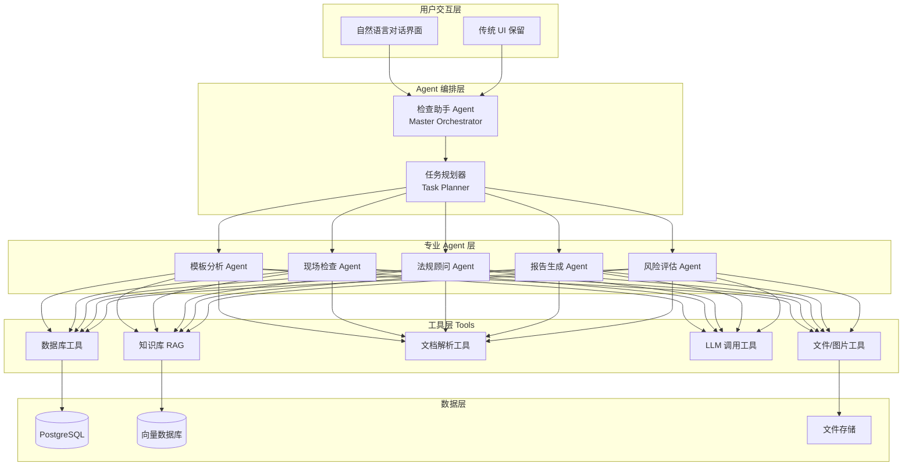
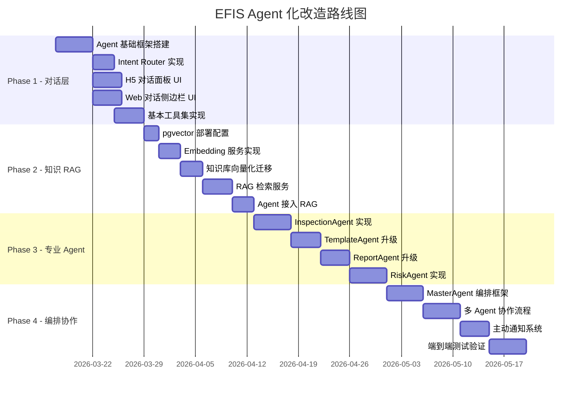

# EFIS 智能体化（Agent化）改造方案

## 一、现状分析

### 1.1 当前系统 AI 能力盘点

| 功能 | 当前实现 | 智能体化差距 |
|------|----------|-------------|
| AI 检查建议 | 单次 LLM 调用，基于 Prompt 生成建议 | 被动工具调用，无自主决策能力 |
| AI 模板提取 | 文档上传 → LLM 解析 → 结构化输出 | 单步执行，无迭代优化和自我纠错 |
| AI 最终判定 | 汇总检查结果 → LLM 生成评价 | 无法主动关联知识库和历史数据 |
| 知识库 | 文档 CRUD，简单关键词搜索 | 无 RAG 检索，未被 AI 利用 |
| 风险画像 | 基于历史记录静态计算 | 无预测能力，无动态调整 |

### 1.2 "APP 已死" 的本质

> 传统 APP 的核心问题不是 "APP" 这种形态本身，而是 **交互范式的低效**——用户需要在固定的 UI 中按照预设路径操作。智能体的核心价值是 **将"用户驱动"变为"目标驱动"**：用户只需描述目标，智能体自主规划和执行。

对于 EFIS 来说，Agent 化不是抛弃现有系统，而是 **在现有系统之上叠加智能体层**。

---

## 二、改造目标与原则

### 2.1 改造目标

```
从 "检查员操作工具" 进化为 "检查员的 AI 搭档"
```

- **短期**（1-2 个月）：将现有 AI 能力升级为 Agent 模式，具备多步推理和工具调用能力
- **中期**（3-4 个月）：构建领域知识 RAG + 多 Agent 协作框架
- **长期**（6+ 个月）：实现自主检查规划、预测性监管智能

### 2.2 改造原则

1. **渐进式改造**：不推翻现有系统，逐层叠加 Agent 能力
2. **保留 UI 但降低依赖**：UI 仍在，但 Agent 可绕过 UI 直接完成任务
3. **人在回路（Human-in-the-Loop）**：关键决策由人类确认，Agent 辅助而非取代
4. **成本可控**：合理利用 LLM 调用，避免 Token 浪费

---

## 三、五层 Agent 化架构



---

## 四、具体改造方案

### 4.1 Phase 1：智能对话层（第 1-2 周）

#### 目标
在 H5 端和 Web 端增加 **AI 对话入口**，让用户可以用自然语言与系统交互。

#### 具体改动

**后端新增：`backend/app/routers/agent.py`**
```
POST /api/agent/chat              # 对话主接口（SSE 流式）
POST /api/agent/chat/action       # Agent 执行动作后的确认
GET  /api/agent/conversations     # 对话历史
```

**核心设计：Intent Router（意图路由器）**

| 用户意图示例 | 路由到 | 执行动作 |
|-------------|--------|---------|
| "帮我看看今天有什么任务" | 任务查询 | 调用 `tasks` API |
| "XX企业上次检查结果怎么样" | 历史查询 | 查企业+记录 |
| "用食品安全模板对XX企业发起检查" | 创建检查 | 自动选模板+企业+创建 |
| "这个检查项应该怎么检查" | 知识查询 | RAG 检索知识库 |
| "当前检查有哪些不合格项" | 检查分析 | 汇总当前记录 |
| "生成检查报告" | 报告生成 | 调用 report_service |

**H5 端：** 底部新增浮动 AI 助手按钮，点击打开对话面板
**Web 端：** 右侧边栏 AI 助手面板

---

### 4.2 Phase 2：知识增强 RAG（第 3-4 周）

#### 目标
将现有知识库升级为向量检索，让 Agent 能精准引用法规、标准。

#### 具体改动

**后端新增：`backend/app/services/rag_service.py`**

```python
# 关键能力
class RAGService:
    async def index_document(doc_id)     # 文档向量化入库
    async def search(query, top_k=5)     # 语义检索
    async def search_by_context(         # 上下文增强检索
        check_item_title,
        industry,
        check_method
    )
```

**技术选型建议**

| 方案 | 优点 | 缺点 | 推荐度 |
|------|------|------|--------|
| **pgvector** (PostgreSQL 扩展) | 无需额外服务，直接用现有 PG | 向量检索性能一般 | ⭐⭐⭐⭐⭐ |
| ChromaDB | 轻量级，Python 原生 | 需额外部署 | ⭐⭐⭐⭐ |
| Milvus | 高性能，分布式 | 部署复杂，对小项目过重 | ⭐⭐ |

> [!IMPORTANT]
> **推荐使用 pgvector**，原因：不增加运维负担，直接给现有 PostgreSQL 加扩展即可。

**改造现有知识库**
- `knowledge_documents` 表增加 `embedding` 向量列
- `inspection_guidelines` 表增加 `embedding` 向量列
- 检查模板的 `legal_basis`、`check_method` 向量化

**Agent 调用链路**

```
用户问: "这个检查项的法规依据是什么？"
         ↓
Agent 提取关键词: 检查项标题 + 行业
         ↓
RAG 检索: 知识库中最相关的 3-5 条法规
         ↓
LLM 结合检索结果 + 检查上下文生成回答
         ↓
返回带引用来源的专业回答
```

---

### 4.3 Phase 3：专业 Agent 群（第 5-8 周）

将现有的单一 LLM 调用改造为多个专业 Agent，各司其职。

#### 3.1 现场检查 Agent（`InspectionAgent`）

**核心能力：** 实时辅助检查员完成现场检查

```python
class InspectionAgent:
    """现场检查智能助手"""
    
    tools = [
        "get_check_item_details",    # 获取检查项详情
        "search_knowledge_base",      # 检索知识库
        "get_enterprise_history",     # 查看企业历史
        "analyze_photo",              # 分析现场照片
        "suggest_check_result",       # 建议检查结果
        "generate_problem_desc",      # 生成问题描述
        "suggest_rectification",      # 建议整改措施
    ]
```

**典型工作流：**

```
检查员拍了一张设备照片
    ↓
Agent 分析照片: "设备铭牌显示出厂日期 2019 年"
    ↓
Agent 查企业档案: "该设备注册日期 2019-03，应在 2024 年前校验"
    ↓
Agent 检索法规: "根据 JJF 1139-2005 第 8.2 条..."
    ↓
Agent 建议: "该设备已超过校验周期，建议判定为不合格"
    ↓
检查员确认或修改
```

#### 3.2 模板 Agent（`TemplateAgent`）

**升级现有 `ai_extract_service.py`**

| 现在 | 改造后 |
|------|--------|
| 一次性提取，出错需重新执行 | 迭代提取，自动验证和纠错 |
| 无法理解上下文 | 结合知识库理解行业规范 |
| 静态 Prompt | 动态 Prompt + Few-shot 示例 |

```
上传文档
    ↓
Agent Step 1: 解析文档结构（识别多级标题 / 表格）
    ↓
Agent Step 2: 提取检查项（调用 LLM）
    ↓
Agent Step 3: 自动验证（检查 JSON 完整性、去重、层级正确性）
    ↓
Agent Step 4: 如有问题 → 自动修正 → 重新验证
    ↓
Agent Step 5: 检索知识库，自动补充法规依据
    ↓
返回高质量结构化模板
```

#### 3.3 报告 Agent（`ReportAgent`）

**升级现有 `report_service.py`**

```
用户说: "生成本次检查报告"
    ↓
Agent 汇总所有检查项结果
    ↓
Agent 分析不合格项模式（是否集中在某类问题）
    ↓
Agent 检索类似企业的历史报告作为参考
    ↓
Agent 用 LLM 生成分析性结论（不只是数据罗列）
    ↓
Agent 生成 PDF / Word 报告
```

#### 3.4 风险评估 Agent（`RiskAgent`）

**升级现有风险画像**

```python
class RiskAgent:
    tools = [
        "get_enterprise_history",       # 历史检查记录
        "get_industry_statistics",      # 行业平均水平
        "get_rectification_records",    # 整改记录
        "predict_risk_trend",           # 预测风险趋势
    ]
```

**能力：**
- 基于历史数据预测企业风险等级变化趋势
- 主动提醒：" XX 企业距上次检查已 6 个月，且上次有 3 项不合格未整改"
- 检查前自动生成 "重点关注清单"

---

### 4.4 Phase 4：多 Agent 编排（第 9-12 周）

#### Master Agent（编排 Agent）

```python
class MasterAgent:
    """主编排 Agent，负责理解用户意图并协调其他 Agent"""
    
    sub_agents = {
        "inspection": InspectionAgent,
        "template": TemplateAgent,
        "report": ReportAgent,
        "risk": RiskAgent,
        "knowledge": KnowledgeAgent,
    }
    
    async def handle(self, user_message, context):
        # 1. 意图分析
        intent = await self.analyze_intent(user_message)
        
        # 2. 制定执行计划
        plan = await self.create_plan(intent, context)
        
        # 3. 按计划调度 Agent
        for step in plan.steps:
            agent = self.sub_agents[step.agent_name]
            result = await agent.execute(step.task, step.tools)
            
        # 4. 汇总结果
        return await self.summarize(results)
```

#### 典型多 Agent 协作场景

```
用户: "准备明天对同仁堂的检查"
    ↓
Master Agent 规划:
  Step 1 → RiskAgent: 获取同仁堂风险画像 + 历史检查情况
  Step 2 → KnowledgeAgent: 检索中药饮片行业最新法规变化
  Step 3 → InspectionAgent: 结合风险点生成"重点关注清单"
  Step 4 → 汇总生成"检查准备简报"
    ↓
输出: 一份包含企业概况、历史问题、法规变化、
      重点关注项的检查准备简报
```

---

## 五、技术实现路径

### 5.1 后端 Agent 框架选择

| 框架 | 特点 | 适合场景 | 推荐 |
|------|------|---------|------|
| **自研（基于 OpenAI Function Calling）** | 最轻量，完全可控 | Phase 1-2 | ⭐⭐⭐⭐⭐ |
| LangChain | 生态丰富，学习曲线中等 | Phase 3 RAG | ⭐⭐⭐⭐ |
| LangGraph | 状态机 Agent，适合复杂流程 | Phase 4 编排 | ⭐⭐⭐⭐ |
| AutoGen (Microsoft) | 多 Agent 对话框架 | Phase 4 协作 | ⭐⭐⭐ |

> [!TIP]
> **推荐路径：Phase 1-2 用自研（Function Calling），Phase 3-4 引入 LangGraph。** 避免一开始就引入重框架。

### 5.2 新增目录结构

```
backend/app/
├── agents/                    # [NEW] Agent 模块
│   ├── __init__.py
│   ├── base.py               # Agent 基类
│   ├── master_agent.py       # 主编排 Agent
│   ├── inspection_agent.py   # 现场检查 Agent
│   ├── template_agent.py     # 模板 Agent
│   ├── report_agent.py       # 报告 Agent
│   ├── risk_agent.py         # 风险评估 Agent
│   ├── knowledge_agent.py    # 知识 Agent
│   └── tools/                # Agent 工具集
│       ├── db_tools.py       # 数据库查询工具
│       ├── rag_tools.py      # RAG 检索工具
│       ├── file_tools.py     # 文件处理工具
│       └── vision_tools.py   # 图片分析工具
├── services/
│   ├── rag_service.py        # [NEW] RAG 检索服务
│   ├── embedding_service.py  # [NEW] 向量化服务
│   └── ...（现有服务保留）
├── routers/
│   ├── agent.py              # [NEW] Agent 对话接口
│   └── ...（现有路由保留）
└── models/
    ├── conversation.py       # [NEW] 对话记录模型
    └── ...（现有模型保留）
```

### 5.3 数据库变更

```sql
-- 新增：对话记录表
CREATE TABLE agent_conversations (
    id UUID PRIMARY KEY DEFAULT gen_random_uuid(),
    user_id UUID REFERENCES users(id),
    title VARCHAR(200),
    context JSONB,      -- 上下文信息（当前检查记录 ID 等）
    created_at TIMESTAMP DEFAULT NOW(),
    updated_at TIMESTAMP DEFAULT NOW()
);

-- 新增：对话消息表 
CREATE TABLE agent_messages (
    id UUID PRIMARY KEY DEFAULT gen_random_uuid(),
    conversation_id UUID REFERENCES agent_conversations(id),
    role VARCHAR(20),   -- 'user' | 'assistant' | 'tool'
    content TEXT,
    tool_calls JSONB,   -- Function Calling 记录
    metadata JSONB,     -- 额外元数据
    created_at TIMESTAMP DEFAULT NOW()
);

-- 扩展：知识库向量索引（需先安装 pgvector）
ALTER TABLE knowledge_documents ADD COLUMN embedding vector(1536);
CREATE INDEX ON knowledge_documents 
    USING ivfflat (embedding vector_cosine_ops);
```

### 5.4 前端改造

**H5 端（Vue 3）**

| 组件 | 说明 |
|------|------|
| `AgentChatPanel.vue` | 浮动 AI 对话面板 |
| `AgentMessage.vue` | 消息气泡（支持 Markdown、工具调用展示） |
| `AgentActionCard.vue` | Agent 提议操作确认卡片 |
| `AgentFab.vue` | 浮动按钮入口 |

**Web 端（React）**

| 组件 | 说明 |
|------|------|
| `AgentSidebar.tsx` | 右侧 AI 助手侧边栏 |
| `AgentChat.tsx` | 对话组件 |
| `AgentToolDisplay.tsx` | 工具调用可视化 |

---

## 六、实施路线图



---

## 七、投入评估

### 7.1 技术投入

| 阶段 | 预估工时 | 人员要求 |
|------|---------|---------|
| Phase 1 | 2-3 周 | 1 后端 + 1 前端 |
| Phase 2 | 2 周 | 1 后端（需 RAG 经验） |
| Phase 3 | 3-4 周 | 1 后端 + 0.5 前端 |
| Phase 4 | 2-3 周 | 1 后端 + 0.5 前端 |
| **合计** | **约 10-12 周** | - |

### 7.2 基础设施成本

| 项目 | 成本评估 |
|------|---------|
| LLM API 调用 | 月增 ¥500-2000（取决于调用频率） |
| pgvector | 无额外成本（PostgreSQL 扩展） |
| Embedding API | 月增 ¥100-500 |
| 服务器升级 | 可能需增加 2-4GB 内存 |

---

## 八、核心价值主张

### 8.1 Before vs After

| 场景 | 现在（传统 APP） | Agent 化之后 |
|------|----------------|-------------|
| **准备检查** | 手动查企业信息 → 选模板 → 查历史记录 | 说"准备明天检查XX企业"→ 自动生成检查简报 |
| **现场检查** | 逐项翻看检查标准 → 手动判断 → 拍照 → 打字记录 | 拍照自动分析 → AI 建议判定 → 语音输入 → 自动关联法规 |
| **找法规** | 搜索关键词 → 翻阅文档 → 手动对照 | 问"这个检查项的法规依据？"→ 精准引用到条款 |
| **写报告** | 手动整理数据 → 填写模板 → 反复修改 | "生成报告"→ AI 分析+撰写+生成 PDF |
| **风险预警** | 看仪表盘数字 → 人工判断 | 系统主动推送"XX企业风险升级，建议优先检查" |

### 8.2 为什么不全部替换为纯 Agent

> [!WARNING]
> **监管检查领域的特殊性：不能完全依赖 AI 决策。**
> - 检查结果具有法律效力，必须由持证检查员确认
> - AI 幻觉在法规引用中可能造成严重后果
> - 用户习惯需要过渡期，不能一刀切

**正确姿态：AI 做 80% 的准备和辅助工作，人做 20% 的判断和确认。**

---

## 九、快速启动建议

如果你想立即开始，我建议从 **Phase 1 的最小可行 Agent** 开始：

1. **后端**：实现一个基于 OpenAI Function Calling 的简单 Agent，能调用 3-5 个现有 API
2. **前端**：在 H5 检查执行页面加一个 AI 对话浮窗
3. **先实现 3 个核心意图**：
   - "这个检查项怎么查？"→ 返回检查方法 + 知识库内容
   - "帮我判断这项合不合格" → 基于上下文建议结果
   - "生成最终判定" → 升级现有 AI 判定功能

这样 **1-2 周就能看到效果**，再逐步扩展。
